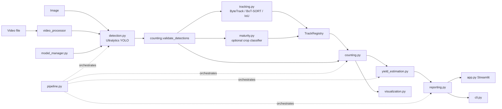

# Fruit Counting & Harvest Estimator

A modular computer-vision application that detects fruit in orchard images and videos, tracks observations
across frames, avoids naive frame-by-frame double counting, optionally classifies visible maturity/condition,
and produces **clearly caveated** harvest estimates with CSV/JSON reports and a Streamlit dashboard.

> **Everything the system outputs is an estimate, never ground truth.** Counts cover fruit *visible* from the
> recorded viewpoint. Harvest numbers depend on calibration values *you* supply. No accuracy figure is claimed
> anywhere in this repository: measure it on your own data (see [Evaluation](#18-performance-evaluation-methodology)).

### Verification status (read this first)

* **Verified in the build environment:** the full pytest suite (102 tests, including a synthetic-video end-to-end
  run and a Streamlit `AppTest` smoke test) passes on Python 3.12.3 with numpy 2.4, pandas 3.0, OpenCV 4.13,
  Streamlit 1.66. The project is written for Python 3.11+; 3.11 itself was not run here.
* **Not verified here:** real inference. PyTorch/Ultralytics and a trained fruit checkpoint were not available,
  so the Ultralytics integration (`YOLO(path)`, `model.predict(...)`, `model.track(..., persist=True, tracker=...)`,
  `boxes.xyxy/conf/cls/id`, `model.val(...)`) is covered by tests against API-shaped stand-ins only. Run the
  [first-run checklist](#17-troubleshooting) on your machine with a real checkpoint before relying on it.
* **No trained weights, dataset, or benchmark results are included.**

## 1. Key features
- Image, file-based video, and (architecture-ready, not implemented) camera input.
- Fruit-specific detector required for real runs; explicit, labelled **demo mode** otherwise.
- Tracking via Ultralytics **ByteTrack / BoT-SORT**, or a built-in IoU tracker for fixed cameras.
- Separate metrics: raw detections, confirmed tracks, estimated unique visible fruit, extrapolated tree totals.
- Optional crop-based maturity/condition classifier (never defaults to "ripe"; low confidence -> `uncertain`).
- Harvest estimator with validated parameters, explicit units, optional visibility correction, and empirical
  prediction intervals only when field-validation data exist.
- Manual review & correction (reject false positives, add missed fruit), tracked separately from model output.
- Reports (JSON/CSV), annotated images/videos, Plotly analytics, secure upload handling.

## 2. Example use cases
Pre-harvest labour/bin planning from fixed-camera rows; comparing flowering/fruit-set between blocks with a
consistent protocol; building a labelled dataset by reviewing detections; benchmarking detectors on your orchard.

## 3. Architecture



Detection, tracking, maturity and harvest estimation are independent modules; the counting and yield modules
have no model dependency and are unit-tested with synthetic detections.

## 4. Technology stack
Python 3.11+, Ultralytics YOLO, PyTorch, OpenCV, NumPy, Pandas, Streamlit, Plotly, PyYAML, dataclasses
(typed config), pytest, stdlib `logging`.

## 5. Project structure
```
app.py                  Streamlit dashboard (presentation only)
config.yaml             central, validated configuration
requirements.txt
src/
  config.py             typed dataclasses + validation (unknown keys rejected)
  schemas.py            Detection, TrackSummary, CountResult, HarvestEstimate, ...
  model_manager.py      checkpoint validation, device fallback, one-time load, demo-mode gating
  detection.py          Ultralytics -> Detection, optional tiled inference
  tracking.py           IoUTracker + TrackRegistry (per-track statistics, diagnostics)
  maturity.py           optional classifier; NullMaturityClassifier never fabricates labels
  counting.py           validation, duplicate suppression, zones, image/video counting
  yield_estimation.py   harvest equations, validation, empirical intervals
  video_processor.py    sequential processing, FPS fallback, guaranteed resource release
  visualization.py      boxes, labels, summary panel
  reporting.py          JSON/CSV reports, stable columns
  pipeline.py           orchestration + recompute after manual review
  review.py, evaluation.py, dataset.py, cli.py, errors.py, logging_utils.py, geometry.py
scripts/train_detector.py   train / val wrapper (Ultralytics)
scripts/split_dataset.py    group-aware split (tree/session/orchard)
data/fruit.yaml  trackers/bytetrack_fruit.yaml  notebooks/  docs/  tests/  outputs/  models/
```

## 6-8. Environment setup
```bash
python3.11 -m venv .venv && source .venv/bin/activate      # Windows: .venv\Scripts\activate
# 1) install PyTorch for your hardware: https://pytorch.org/get-started/locally/
pip install -r requirements.txt
pytest                                                      # core tests need no GPU/weights
```

## 9. Dataset preparation
```
data/images/{train,val,test}/IMG_0001.jpg
data/labels/{train,val,test}/IMG_0001.txt      # "class x_center y_center width height" normalised to 0..1
data/fruit.yaml                                # class names; ids must match the label files
```
* Annotate **every visible fruit** (also partly occluded ones you would count) consistently; decide a rule for
  fruit < N pixels and for heavily occluded fruit, and apply it uniformly.
* **Avoid leakage:** split by *tree, recording session or orchard block*, never by random frame. Adjacent video
  frames and multiple views of one tree are near-duplicates. Use
  `python scripts/split_dataset.py --manifest manifest.csv --src-images raw/images --src-labels raw/labels`
  with a CSV of `image,group`.
* Keep a final **test** split untouched until the end; ideally from a different orchard/season.
* **Licences:** record the licence, source and required attribution of every dataset/image; some public fruit
  datasets forbid commercial use. Pretrained weights (Ultralytics is AGPL-3.0 unless you hold an enterprise
  licence) carry their own terms.
* Other species (orange, strawberry, mango, pear, peach): add class names in `data/fruit.yaml` and
  `fruit.species`. Do not assume an apple model transfers; validate each species/variety/camera setup.
* Maturity classifier (optional): classification folders `data/maturity/{train,val}/<label>/*.jpg` of fruit crops
  labelled by an expert or by field measurements; train with `yolo classify train data=data/maturity model=yolov8n-cls.pt`.

## 10. Model training
```bash
python scripts/train_detector.py train --data data/fruit.yaml --weights yolov8s.pt --epochs 100 --imgsz 960 --batch 8
cp runs/fruit/exp/weights/best.pt models/best.pt
```
Higher `imgsz` helps small/distant fruit (slower). For dense clusters of tiny fruit enable `model.tiling_enabled`
or train an instance-segmentation model. A generic COCO checkpoint is **not** a fruit detector for orchards.

## 11. Model validation
```bash
python scripts/train_detector.py val --data data/fruit.yaml --weights models/best.pt --split test
```
Prints precision, recall, mAP@50, mAP@50-95 and the measured inference ms/FPS on your hardware.

## 12. Image inference
```bash
python -m src.cli image --input orchard_tree.jpg                  # uses models/best.pt from config.yaml
python -m src.cli image --input tree.jpg --conf 0.3 --device cpu
python -m src.cli image --input tree.jpg --demo                   # generic COCO model, labelled DEMO
```
Writes `outputs/annotated/<id>_annotated.jpg` and reports in `outputs/reports/`.

## 13. Video inference
```bash
python -m src.cli video --input input_orchard.mp4 --output output_annotated.mp4 --camera fixed
python -m src.cli video --input row.mp4 --stride 2                # analyse every 2nd frame (see limitations)
```
Defaults come from `video.input_path` / `video.output_path`. Frames are processed sequentially (not held in
RAM). Timestamps are `frame_index / fps`; if FPS metadata is invalid, `video.fallback_fps` is used and the
fallback is recorded in the report. The HUD shows *running* confirmed tracks; only the report holds the final figure.

### Counting definitions
| Name | Definition |
|---|---|
| `raw_frame_detections` | every box in every processed frame - **never** a video fruit count |
| `confirmed_tracks` | tracks seen in >= `tracking.min_confirm_observations` processed frames |
| `estimated_unique_visible_fruit` | image: counted boxes after validation/dedup; video: confirmed tracks after review |
| `estimated_total_tree_fruit` | unique visible / `visibility_fraction`, only if you configure it |

A track id is **not** proof of a globally unique fruit. Fixed camera: one track ~ one fruit (ID switches still
happen; see `track_diagnostics`). Moving camera: counts are labelled *best effort*; the same fruit can get several
ids. Globally unique counts need camera-motion compensation or multi-view association/3D reconstruction, which are
**not implemented**. Observation zones (`counting.zones`, normalised boxes) give per-zone counts and can restrict
counting to a region; they are not tree identification.

## 14. Dashboard
```bash
streamlit run app.py
FRUIT_ADMIN_PASSWORD=secret streamlit run app.py     # require a password to edit calibration
```
Tabs: Overview, Input, Detection review (reject/add fruit, recompute), Analytics, Calibration, Export.
Uploads: extension whitelist, size limit, random internal filename, deleted right after processing; saved
outputs live in `outputs/` until you delete them (button in Export tab). Videos above
`dashboard.max_video_frames` are processed partially and flagged. Dashboard review edits do not re-render the
annotated *video* (it shows model output).

## 15. Reports
See [docs/REPORT_SCHEMA.md](docs/REPORT_SCHEMA.md) and the synthetic [docs/sample_report.json](docs/sample_report.json).

## 16. Configuration guide
All keys live in `config.yaml` and are validated at startup (typos rejected). Key calibration inputs:

| Key | Meaning | Default |
|---|---|---|
| `fruit.average_weight_grams` | per-species mean fresh weight from physical measurement | `{}` (weight not estimated) |
| `harvest.harvestable_probability` (+`_by_species`) | calibrated share of visible fruit that will be harvested | `null` (not estimated) |
| `harvest.visibility_fraction` | share of the tree's fruit visible, in (0, 1] | `null` (no extrapolation) |
| `harvest.validation_pairs_path` | CSV `predicted_weight_kg,actual_weight_kg` from field trials | `null` (no interval) |
| `tracking.camera_mode` | `fixed` or `moving` (best-effort) | `fixed` |

Equations: `visible_harvestable = unique_visible * p`; `weight_kg = harvestable * avg_g / 1000`;
`total_tree = unique_visible / visibility_fraction`. Unrounded values are stored; rounding is display-only.
Bounding-box area is **not** converted to mass (needs calibrated camera geometry). Uncertainty intervals are
empirical quantiles of `actual/predicted` from your validation pairs (>= `min_validation_samples`), valid only for
similar conditions; otherwise no interval is shown.

## 17. Troubleshooting
| Symptom | Cause / fix |
|---|---|
| `No trained fruit detector is available` | `models/best.pt` missing: train one (section 10) or use `--demo` for a labelled demo |
| `checkpoint has no class matching fruit.species` | class names in the model differ from `fruit.species`; fix config or retrain |
| CUDA requested but CPU used | log line explains (CPU-only torch build, driver, no GPU); install a CUDA build of PyTorch |
| `Cannot open video writer` | codec unavailable; try `video.codec: avc1`/`XVID` or another OpenCV build |
| Annotated video won't play in browser | `mp4v` isn't browser-friendly: set `video.transcode_h264: true` (needs ffmpeg) |
| Counts too high on video | track fragmentation: raise `min_confirm_observations`, tune tracker, check `track_diagnostics` |
| Counts too low | lower `model.conf`/`counting.min_confidence`, raise `imgsz`, try tiling, retrain with more small-fruit examples |
| Tracker errors about `lap` | let Ultralytics auto-install it or `pip install lapx` |

First-run checklist with a real checkpoint: (1) `python -m src.cli image --input sample.jpg`; (2) confirm boxes
align with fruit; (3) run a short video with `--stride 1`; (4) compare against a manual count.

## 18. Performance evaluation methodology
Use tree- or recording-level test splits and manually annotated ground truth.
* **Detector:** precision, recall, mAP@50, mAP@50-95 via `train_detector.py val`.
* **Counts:** MAE, RMSE, bias, MAPE: `python -m src.cli evaluate-counts --csv results.csv --pred predicted --truth manual_count --group lighting`
  (the `--group` column splits errors by lighting, canopy density, fruit size, ...).
* **Harvest weight:** compare `visible_harvest_weight_kg`/`tree_harvest_weight_kg` with measured harvested weight;
  feed (predicted, actual) pairs back as `harvest.validation_pairs_path` for empirical intervals.
* **Tracking:** ID switches / fragmentation against hand-labelled track identities (HOTA/IDF1 with an external
  tool such as TrackEval); the registry's `track_diagnostics` are indicators, not metrics.
* **Speed:** `val` prints inference ms/img; the video report records end-to-end throughput.
Report errors per condition when enough data exist. Publish only numbers you measured.

## 19. Known limitations
Hidden fruit is invisible; ID switches and merges; moving-camera counts are best effort; frame stride may skip
fruit and break tracks; tiled inference can still split fruit at tile borders; maturity labels are visual only
(not physiological maturity or harvest readiness); the harvest probability, average weight and visibility
fraction are user assumptions; a COCO demo model is not validated for orchards; maturity per track is a vote over
a limited number of observations; camera mode is not implemented; `mp4v` output may need transcoding.

## 20. Roadmap
Camera-motion compensation and multi-view fruit association; instance segmentation and fruit-size/volume from
calibrated geometry; per-fruit harvest probabilities by maturity/condition from field data; tree-level yield
forecasting with weather/history; geospatial orchard maps; drift monitoring; retraining from reviewed
annotations; edge/mobile export; farm-management integration. None are implemented with placeholder data.

## 21. Dataset and model attribution
Record here the datasets, annotators and pretrained weights you used, with licences:
`<dataset name> - <source URL> - <licence> - <required attribution>`. This repository ships none.

## 22. Licence considerations
Add your own `LICENSE` for this code. Ultralytics YOLO is AGPL-3.0 (commercial licence available) - assess
obligations before distributing or offering it as a network service. Check dataset licences (non-commercial
clauses), and obtain consent/permission for imagery of private land or people.
